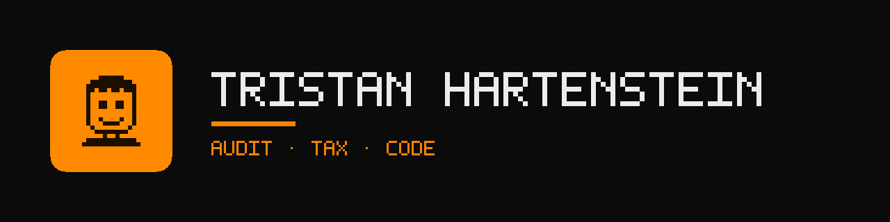

# Tristan Hartenstein

Quantitative research on **decisions under uncertainty**: how much to bet, how to allocate, and how to tell
an edge from noise. Every project here is a small research study: a question, a method that can be checked,
code that regenerates every number, and a paper that says what did not work.

**Research focus**

- **Portfolio construction and empirical finance:** point-in-time data, trading costs, honest statistics
  (deflated Sharpe ratios, multiple-testing corrections).
- **Game theory and betting:** Kelly sizing, finite-shoe probability, equilibrium computation.
- **The link between them:** estimation risk. A strategy is only as good as what you can know about it
  from the data you have.

---

### Research

| Project | Question | Stack |
|---|---|---|
| **[Kelly Under Uncertainty](https://github.com/Tristan-sketch/kelly-under-uncertainty)** [Website](https://tristan-sketch.github.io/kelly-under-uncertainty/) · [Paper (PDF)](https://tristan-sketch.github.io/kelly-under-uncertainty/report.pdf) | How much should a Kelly bettor shrink the stake when the edge is only estimated? A closed form, exact binomial results for discrete bets, and out-of-sample evidence from six DAX factor portfolios. | Python · NumPy · SciPy · LaTeX |
| **[Counterfactual Regret](https://github.com/Tristan-sketch/counterfactual-regret)** [Website](https://tristan-sketch.github.io/counterfactual-regret/) · [Paper (PDF)](https://tristan-sketch.github.io/counterfactual-regret/report.pdf) | How fast do CFR, CFR+, discounted CFR and Monte Carlo CFR find a Nash equilibrium? Solved from scratch on Kuhn poker and Leduc hold'em, scored by exact exploitability and checked against the analytic Kuhn equilibrium. | Python · NumPy · LaTeX |
| **[DAX Quant Research](https://github.com/Tristan-sketch/dax-quant-research)** [Website](https://tristan-sketch.github.io/dax-quant-research/) · [Paper (PDF)](https://tristan-sketch.github.io/dax-quant-research/report.pdf) | Do documented equity factors survive in the DAX once the universe is point in time, trades cost money and every variant counts as a trial? Updated every month. | Python · pandas · statsmodels · LaTeX · GitHub Actions |
| **[Blackjack Counter](https://github.com/Tristan-sketch/blackjack-counter)** | Blackjack as a finite-shoe probability model: basic strategy, a Wong Halves counter, index plays, next-card odds and Kelly bet sizing. | Python · tkinter · pytest |

**Next:** out-of-sample portfolio optimisation with covariance shrinkage on the point-in-time DAX universe.

Earlier: [BlogPost](https://github.com/Tristan-sketch/BlogPost), a full-stack Next.js app (archived).

### How the projects are built

- **One command rebuilds everything:** data, results, figures, the LaTeX paper and the website.
- **No hard-coded results:** every number in a paper is a generated macro, so text cannot go stale.
- **Tests for the mathematics:** closed forms are checked against numerical integration and simulation,
  backtests against look-ahead.
- **Limitations are part of the result.**

### Toolbox

All banners and the avatar on this account are pixel art drawn by one script: [`tools/make_images.py`](tools/make_images.py).
